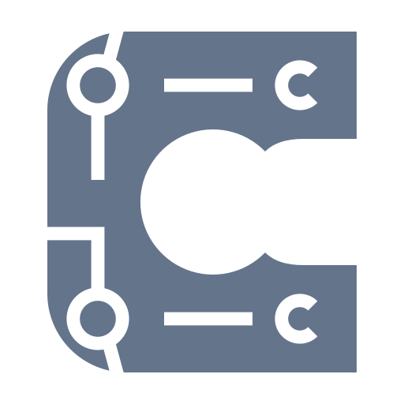

<p align="center">
  
</p>

# Conveyor Laravel Broadcaster

Use [Socket Conveyor](https://github.com/firebrikdotcom/socket-conveyor) as a Laravel broadcasting driver. Composer package: [`firebrikdotcom/conveyor-laravel-broadcaster`](https://packagist.org/packages/firebrikdotcom/conveyor-laravel-broadcaster).

Version **0.3.0** is published as `firebrikdotcom/conveyor-laravel-broadcaster` on Packagist. Existing projects using `kanata-php/conveyor-laravel-broadcaster` can migrate by updating their Composer requirement; the previous package remains available.

## Requirements

Release **0.3.0** requires PHP **8.3+** and Laravel **13+**. The development suite uses PHP **8.4.1+** and PHPUnit 13; CI also tests the PHP 8.3 runtime with PHPUnit 12.5. PHP 8.5 is supported.

Run a Conveyor server exposing `/conveyor/message` and `/conveyor/auth`. The Laravel application communicates over HTTP(S), so it does **not** need OpenSwoole or a local Conveyor server installation. Optional server-side user-association helpers accept Socket Conveyor's `UserAssocPersistenceInterface`; use them in a separately provisioned compatible server process. Unit tests use isolated copies of that optional interface, not a running WebSocket server.

The PHP [`conveyor-server-client`](https://packagist.org/packages/firebrikdotcom/conveyor-server-client) is a separate WebSocket integration. This driver does not call its API or depend on that package.

## Install

```sh
composer require firebrikdotcom/conveyor-laravel-broadcaster:^0.3
php artisan vendor:publish --provider='Kanata\LaravelBroadcaster\ConveyorServiceProvider'
php artisan install:broadcasting --without-reverb --without-node
```

Laravel discovers the service provider automatically. Add this entry **inside `connections`** in `config/broadcasting.php`:

```php
'connections' => [
    // Other connections...
    'conveyor' => ['driver' => 'conveyor'],
],
```

Set the transport in `.env`; the published `config/conveyor.php` is the single source for host, port, protocol and query:

```dotenv
BROADCAST_CONNECTION=conveyor
CONVEYOR_PROTOCOL=ws
CONVEYOR_URI=127.0.0.1
CONVEYOR_PORT=8002
CONVEYOR_QUERY="token=your-server-secret"
```

`ws` selects HTTP and `wss` selects HTTPS for the server API. Use `wss` outside trusted local networks. Keep the server secret on the backend. An empty query disables token retrieval and `Conveyor::getToken()` returns an empty string.

## Broadcast an event

Follow [Laravel broadcasting](https://laravel.com/docs/13.x/broadcasting) to register your authorization callbacks and authenticated broadcasting routes. A minimal event is:

```php
namespace App\Events;

use Illuminate\Broadcasting\Channel;
use Illuminate\Contracts\Broadcasting\ShouldBroadcastNow;

class MessageSent implements ShouldBroadcastNow
{
    public function __construct(public string $message) {}

    public function broadcastOn(): array
    {
        return [new Channel('room')];
    }
}

// In an application controller:
event(new \App\Events\MessageSent('Hello Conveyor'));
```

`ShouldBroadcast` also works when a queue worker is running. The driver sends the JSON event payload to each channel; the Laravel event name is currently not transmitted as a separate field. HTTP errors and invalid JSON throw, allowing queued jobs to fail or retry instead of silently losing messages.

For browser integration, install `socket-conveyor-client` and follow its current API documentation. Fetch private-channel credentials only from an authenticated, authorized endpoint. For example, after authorizing access to the requested channel on the backend:

```php
use Kanata\LaravelBroadcaster\Conveyor;

$token = Conveyor::getToken('private-room');
```

This asks the server for a channel token; it does not itself authorize your application user. Never put the server query secret in browser JavaScript, render untrusted messages with `innerHTML`, or log users in automatically for a demo.

## Optional local token storage

`conveyor:token`, `ConveyorDriver::validAuthenticationResponse()` and the server-side token helpers use a `conveyor_tokens` table. Create an application migration:

```php
use Illuminate\Database\Migrations\Migration;
use Illuminate\Database\Schema\Blueprint;
use Illuminate\Support\Facades\Schema;

return new class extends Migration {
    public function up(): void
    {
        Schema::create('conveyor_tokens', function (Blueprint $table) {
            $table->id();
            $table->string('name');
            $table->foreignId('user_id');
            $table->string('aud')->nullable();
            $table->text('token');
            $table->string('aud_protocol')->nullable();
            $table->integer('allowed_uses')->nullable();
            $table->integer('uses')->nullable();
            $table->dateTime('expire_at')->nullable();
            $table->timestamps();
        });
    }

    public function down(): void
    {
        Schema::dropIfExists('conveyor_tokens');
    }
};
```

```sh
php artisan migrate
php artisan conveyor:token 1
```

Configure `conveyor.database-driver` with a Laravel connection name if these records live outside your default database. `auth.providers.users.model` selects the related user model. Custom user IDs must be integers for these helpers.

`JwtToken::create($name, $userId, $expire, $useLimit)` takes expiry in seconds (or `null`) and a positive use count (or `null` for unlimited). JWT 7 requires an HS256 signing name of at least **32 bytes**. Generated command and driver names meet that requirement. Store those signing names securely. Expired records are rejected; limited tokens persist both `allowed_uses` and remaining `uses`. Older tokens created with a limit may have `uses = null` because the previous implementation dropped the limit: revoke or backfill those records before upgrading if they were intended to be limited.

## Upgrade from 0.2

0.3.0 is a breaking minor release while the package is pre-1.0:

- Upgrade PHP 8.2 to 8.3+ and Laravel 11/12 to 13+.
- Upgrade JWT 6 to 7 and use signing names of at least 32 bytes.
- Guzzle 8 is now a declared runtime dependency, alongside the Illuminate components used by the driver. Resolve application dependency conflicts before deployment.
- Handle HTTP/JSON exceptions, expired-token rejection and enforced token use limits.
- Remove any copied `config.platform.ext-openswoole` override. No fake platform extension is needed.

## Development and release checks

```sh
composer install
composer check
composer coverage
composer audit
composer archive --format=zip --dir=coverage --file=conveyor-laravel-broadcaster-0.3.0
```

Tests require PDO SQLite. Coverage requires Xdebug or PCOV configured to include `src/`. The archive excludes development tooling, tests, vendor files and the lockfile. CI tests PHP 8.3, 8.4 and 8.5, runs analysis/style/security checks and prepares an archive; it never publishes.

Packagist registers `firebrikdotcom/conveyor-laravel-broadcaster` from [this repository](https://github.com/firebrikdotcom/conveyor-laravel-broadcaster), with **0.3.0** published under the new name. For future releases, verify maintainer and webhook access, publish a new version tag, and confirm Packagist indexes that exact commit. The previous `kanata-php/conveyor-laravel-broadcaster` package remains available for existing installations. See [CHANGELOG.md](CHANGELOG.md) for release notes. No credentials are required for local checks.

## License

[MIT](LICENSE).
